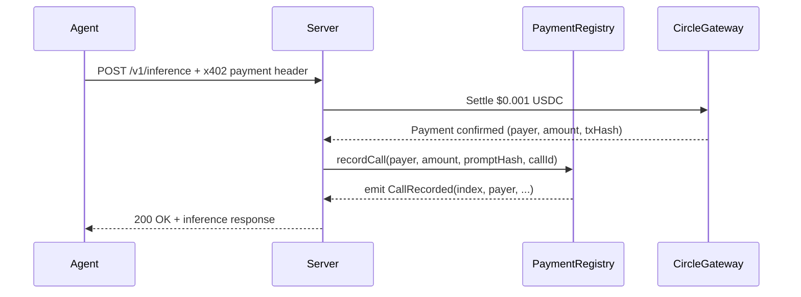

# PaymentRegistry — Smart Contract Design Doc

**Status:** Draft  
**Authors:** Arc Studio  
**Target chain:** Arc Testnet (chain ID 5042002) → Arc Mainnet post-audit  
**Language / toolchain:** Solidity 0.8.28, Foundry (forge 0.3.x)  
**Milestone:** v1.0 — initial deploy alongside Arc Payment Rail API server  

---

## Review Tracker

- [ ] Design review
- [ ] Security review
- [ ] Ops review

---

## Action Items (living)

_Empty at draft. Populated after each review round._

---

## 1. Goals / Non-Goals

### Goals

- Record every paid API call as an immutable onchain receipt, accessible to any caller.
- Store: payer address, block timestamp, USDC amount (in raw 6-decimal units), keccak256 hash of the prompt, and a string call ID supplied by the recorder.
- Allow **any address** to record a call — the server records after each Gateway settlement, but agents or third parties may also record their own calls.
- Emit a queryable event per record so off-chain indexers can reconstruct the full history.
- Keep gas cost per record low (target: < 80,000 gas on Arc).

### Non-Goals

- Does **not** custody or move USDC — it is a write-only ledger, not a payment processor.
- Does **not** validate whether a payment actually occurred — callers are trusted to supply accurate data.
- Does **not** implement upgradeability — fixed bytecode, no proxy.
- Does **not** have an owner, admin, or pause mechanism — fully permissionless.
- Does **not** implement any ERC standard (not ERC-20, ERC-721, etc.).

---

## 2. Requirements

### Functional

- `recordCall(address payer, uint256 amount, bytes32 promptHash, string calldata callId)` — writes one record and emits `CallRecorded`.
- `getCall(uint256 index)` — returns the full record at a given index (0-based).
- `callCount()` — returns the total number of records.
- `getCallsByPayer(address payer, uint256 offset, uint256 limit)` — returns a page of record indices for a given payer.

### Security

- No privileged roles — no function may be guarded by an access modifier that restricts callers.
- No USDC is held or transferred — no `transfer`, `transferFrom`, or `approve` calls.
- No external calls of any kind — no re-entrancy surface.
- All storage writes are bounded — no unbounded loops in write paths.
- Timestamp is `block.timestamp` — used only for ordering and display, never for value or randomness.
- Integer arithmetic uses Solidity 0.8 checked math — no `unchecked` blocks.

---

## 3. Terminology & Actors

| Term | Definition |
|------|-----------|
| **Record** | One onchain entry representing a single paid API call |
| **Payer** | The agent wallet address that paid USDC for the call |
| **Recorder** | The address that called `recordCall` (may differ from payer) |
| **Call ID** | A server-assigned string (e.g. UUID) identifying the call |
| **Prompt hash** | `keccak256(abi.encodePacked(prompt))` — a fingerprint of the prompt, not the prompt itself |

| Actor | On/off-chain | Trust level | Abilities |
|-------|-------------|-------------|-----------|
| **Recorder** (server or any address) | On-chain | Untrusted | Call `recordCall` with any data — no validation of accuracy |
| **Reader** (anyone) | On-chain / off-chain | Untrusted | Read records via view functions or events |

---

## 4. Language / Runtime

- **Language:** Solidity 0.8.28 (checked arithmetic by default; no overflow risk)
- **EVM version:** Paris (as pinned in `foundry.toml`) — no PUSH0, no transient storage
- **Toolchain:** Foundry forge 0.3.x
- **Base contracts:** None — no OpenZeppelin inheritance needed for a pure storage contract
- **Compiler settings:** `optimizer = true`, `optimizer_runs = 200`

---

## 5. Transaction & Execution Model

Each call to `recordCall` is a single atomic transaction. It:
1. Appends one `CallRecord` struct to the `_records` array.
2. Appends the new index to the `_payerIndices[payer]` mapping.
3. Emits `CallRecorded`.

No external calls are made. No re-entrancy surface exists. CEI ordering is maintained trivially (no effects that depend on an external call's return value).

---

## 6. Chain Standards & Interfaces

No ERC standard is implemented. No interface is inherited. The contract exposes a minimal ABI of four functions.

---

## 7. Architecture Overview



### Flow of funds

| Step | Who moves what | Invariant |
|------|---------------|-----------|
| Gateway settlement | Circle Gateway moves USDC from agent to seller | Handled entirely by Circle Gateway — PaymentRegistry has no role |
| `recordCall` | No funds moved | Contract USDC balance is always zero |

**Resting-state invariant:** The contract holds zero USDC and zero native token at all times.

---

## 8. Contract Design

### Roles

None. Fully permissionless.

### Storage layout

```solidity
struct CallRecord {
    address payer;        // slot word 1 (20 bytes)
    uint96  amount;       // slot word 1 (12 bytes) — packed with payer
    uint256 timestamp;    // slot word 2
    bytes32 promptHash;   // slot word 3
    string  callId;       // dynamic — stored in heap
}

CallRecord[] private _records;                          // array of all records
mapping(address => uint256[]) private _payerIndices;   // payer => indices into _records
```

`payer` (20 bytes) and `amount` (12 bytes) are packed into one 32-byte slot. `uint96` safely holds USDC amounts up to ~79 billion USDC (6 decimals), well beyond any realistic value.

### Modifiers

None.

### Functions

#### WRITE

| Signature | Caller | State mutated | Events | Revert conditions |
|-----------|--------|--------------|--------|-------------------|
| `recordCall(address payer, uint256 amount, bytes32 promptHash, string calldata callId)` | Anyone | Appends to `_records`; appends index to `_payerIndices[payer]` | `CallRecorded` | `payer == address(0)`, `amount == 0`, `bytes(callId).length == 0` |

#### READ (view)

| Signature | Returns |
|-----------|---------|
| `callCount()` | `uint256` — total records |
| `getCall(uint256 index)` | `CallRecord` — full record at index; reverts if out of bounds |
| `getCallsByPayer(address payer, uint256 offset, uint256 limit)` | `uint256[] memory` — indices; empty if none; capped at `limit` |

### Events

| Event | Params | Indexed | When emitted |
|-------|--------|---------|-------------|
| `CallRecorded` | `uint256 indexed index, address indexed payer, uint256 amount, uint256 timestamp, bytes32 promptHash, string callId` | `index`, `payer` | On every successful `recordCall` |

---

## 9. Specification: recordCall feature

### Invariants

1. `callCount()` strictly increases by 1 after each successful `recordCall`.
2. `getCall(callCount() - 1).payer` equals the `payer` argument of the most recent `recordCall`.
3. For all `i` in `getCallsByPayer(p, 0, type(uint256).max)`: `getCall(i).payer == p`.
4. The contract's native and USDC balance is always zero.
5. `recordCall` with `payer == address(0)` always reverts.

### Functionalities

| Functionality | Restriction | Note | Event |
|--------------|-------------|------|-------|
| Record a call | Anyone, non-zero payer, non-zero amount, non-empty callId | Appends; never overwrites | `CallRecorded` |
| Read a record by index | Anyone | View only; reverts on out-of-bounds | — |
| Read total count | Anyone | View only | — |
| Read indices by payer | Anyone | Paginated; returns empty array if none | — |

---

## 10. Deployment & Initialization

- **Constructor:** takes no arguments. No `initialize` needed (not upgradeable).
- **Deploy command:** `forge build` then `deploy_contract` tool (Mode 1 — Arc Testnet first, Arc Mainnet after audit sign-off).
- **Post-deploy:** record the contract address in `AGENTS.md` and wire the server to call `recordCall` after each Gateway settlement.
- **Key at genesis:** no privileged key. The deployer address has no special powers after deploy.

---

## 11. Upgradeability

Not upgradeable. Fixed bytecode. Migration story: if a v2 is needed, deploy a new address and update the server's `REGISTRY_ADDRESS` env var. Old records remain readable at the v1 address permanently.

---

## 12. Key Management & Signing

No privileged keys. No signing scheme. No replay protection needed (no signatures).

---

## 13. Security Considerations

| Vulnerability | Applicable? | Mitigation |
|--------------|-------------|-----------|
| Reentrancy | No | No external calls of any kind |
| Access control | No | Fully permissionless by design — no privileged functions |
| Integer overflow/underflow | Solidity 0.8 checked | No `unchecked` blocks; `uint96` for amount is safe up to ~79B USDC |
| Unchecked external call / return | No | No external calls |
| Fee-on-transfer / rebasing tokens | No | No token interaction |
| Signature replay | No | No signatures |
| Front-running / MEV | No | Write-only ledger; no extractable value |
| Flash-loan / price manipulation | No | No price oracle or value logic |
| Oracle manipulation | No | No oracle |
| Denial of service | Low | `getCallsByPayer` is a view with a `limit` cap; write path appends one element |
| Delegatecall / proxy safety | No | No proxy, no delegatecall |
| Timestamp / block dependence | Low | `block.timestamp` used for display only, not for value or access control |
| Approval persistence | No | No token approvals |
| Centralization risk | No | No owner, no admin, no pauser |
| Unbounded storage growth | Note | `_records` grows forever — acceptable for a ledger; no on-chain loop reads it in full |
| Data accuracy | Note | Records are caller-supplied; no validation of whether payment actually occurred |

---

## 14. Trust Model & Threat Analysis

| Actor | Max damage if compromised | Mitigation | Detection |
|-------|--------------------------|-----------|-----------|
| **Recorder (any address)** | Can write false records (wrong payer, wrong amount) | Records are caller-supplied; consumers must cross-check with Circle Gateway events | Monitor `CallRecorded` events; compare with Gateway settlement logs |
| **No owner / admin** | N/A — no privileged key exists | — | — |

---

## 15. Emergency Response & Circuit Breakers

None — the contract is fully permissionless and holds no funds. No pause mechanism is needed or desirable. If a bug is found, deploy a v2 and point the server at the new address; the old address remains readable.

---

## 16. Failure Scenarios

| Scenario | Outcome |
|---------|---------|
| Server calls `recordCall` with wrong payer | Record is written with wrong data; no funds at risk; detectable by comparing with Gateway logs |
| `recordCall` called with `payer == address(0)` | Reverts cleanly — zero address is an explicit guard |
| Disk full / storage limit hit | Extremely unlikely on Arc; if hit, new records fail with out-of-gas; old records remain readable |
| Contract address lost | Records still queryable by scanning `CallRecorded` events from the deploy block |

---

## 17. Priorities & Tradeoffs

| Decision | Tradeoff | Rationale |
|---------|---------|-----------|
| Fully permissionless writes | Anyone can write false records | Simplicity wins — no auth needed for a ledger that holds no value; cross-check with Gateway events for truth |
| `uint96` for amount | Max ~79B USDC | Saves one storage slot per record via packing; realistic max is far below uint96 |
| No upgradeability | New address on v2 | Simpler security model; fixed bytecode is easier to audit and trust |
| `block.timestamp` | Manipulable by ±15s by validators | Acceptable for a display timestamp on a low-value ledger |
| No prompt text onchain | Privacy | Only the keccak256 hash is stored; the prompt itself stays off-chain |

---

## 18. Testing Strategy

- **Unit tests (Foundry):** happy path, revert paths (zero payer, zero amount, empty callId), event emission, fuzz `amount` and `promptHash`, invariant that `callCount` only increases.
- **Static analysis:** Slither on `PaymentRegistry.sol`.
- **Coverage target:** 100% branch coverage (small surface area).
- **Run command:** `forge test -vvv` from project root.

---

## 19. Third-Party Libraries

| Library | Version | Already a dep? | Why chosen | Security-reviewed? |
|---------|---------|---------------|-----------|-------------------|
| None | — | — | Contract is self-contained | — |

---

## 20. Monitoring & Alerting

| Event / metric | Threshold | Severity | Playbook |
|---------------|----------|---------|---------|
| `CallRecorded` payer != expected | Any mismatch vs Gateway log | Medium | Cross-check server logs; investigate recorder address |
| Unusual burst of `recordCall` from unknown address | > 100/min | Low | Rate-limit at server; investigate |

---

## 21. Common Patterns / Worked Examples

### Happy path: server records a paid call

1. Agent sends `POST /v1/inference` with x402 payment header.
2. Circle Gateway settles $0.001 USDC from agent to seller.
3. Server calls `recordCall(agentAddress, 1000, keccak256(prompt), "uuid-abc123")`.
4. Contract appends record at index `N`, updates `_payerIndices[agentAddress]`.
5. Emits `CallRecorded(N, agentAddress, 1000, block.timestamp, promptHash, "uuid-abc123")`.
6. Server returns 200 OK with inference result.

### Reading back a record

```solidity
uint256 n = registry.callCount(); // e.g. 42
PaymentRegistry.CallRecord memory r = registry.getCall(41);
// r.payer, r.amount, r.timestamp, r.promptHash, r.callId
```
